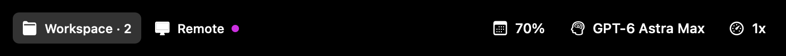

# Codex Touch Bar

A macOS menu bar helper that puts Codex projects, unread results, weekly allowance, and the current task's model and speed on your MacBook Pro Touch Bar. No BetterTouchTool required; the Codex app is not modified or re-signed.

[Download v0.2.7 for Apple Silicon](https://github.com/MarlonJD/codex_touchbar/releases/download/v0.2.7/CodexTouchBar-v0.2.7-macOS.zip) · [All releases](https://github.com/MarlonJD/codex_touchbar/releases)



*Illustration rendered with the app's own image renderer using sample projects and values. This is not a device screenshot; macOS system controls are omitted.*

## What it does

The controls appear while Codex is the frontmost app.

| Control | Behavior |
| --- | --- |
| Projects | Scroll horizontally. Tap to open an unread result first, then cycle through active tasks. |
| Selected project | A rounded background follows the project selected in Codex. |
| Unread results | A purple dot marks a project with unread results. Reading one result preserves the dot if another result is still unread. |
| Weekly allowance | Shows the remaining account percentage reported by Codex. |
| Model and effort | Shows the visible task's selection, such as **GPT-6 Astra Max**. Tap to choose Low, Medium, High, Extra High, Max, or Ultra effort. |
| Speed | Shows **1x** or the current model's advertised Fast multiplier. Tap to select standard or Fast mode. |

Local projects use a folder icon, remote projects use a computer icon, and cloud tasks appear under **Bulut** with a cloud icon. Projects on different hosts stay separate even when their paths match. Projectless tasks appear under **Görevler**.

Model and speed labels follow changes made in Codex itself. An em dash means the current selection could not be identified. The project strip makes room for longer model names, and an expansion chevron appears when projects overflow the compact strip.

## What's new in 0.2.7

- Fix model and speed labels getting stuck on **—** when Codex's controls are deeply nested in its accessibility tree.
- Show live task settings, including **Max** effort and model-specific Fast multipliers.
- Track local, remote, and cloud task state, including read receipts for completed results.
- Read weekly allowance from the account API without blocking project or setting updates.
- Improve compact layout, project overflow controls, and signing identity selection for local builds.

## Requirements

- A MacBook Pro with a physical Touch Bar
- macOS 13 or later
- The Codex desktop app installed at `/Applications/ChatGPT.app`
- Accessibility access for model/effort and speed controls

The published ZIP is **Apple Silicon (arm64)**. An Intel build has not been verified for this release.

The helper relies on Codex's internal desktop state protocol and Apple's private Touch Bar presentation API. App updates can change these interfaces.

## Install

1. Download the notarized ZIP linked above.
2. Extract `Codex Touch Bar.app` and move it to `/Applications`.
3. Open the app once.
4. In the helper's menu bar menu, choose **Enable Effort & Speed Controls…**, then allow **Codex Touch Bar** in **System Settings → Privacy & Security → Accessibility**.

The helper registers itself as a macOS login item on first launch. Use its menu bar icon to refresh task discovery, enable or disable Touch Bar presentation, open Codex, or quit. If the helper asks you to restart Codex after preparing its keyboard commands, quit and reopen Codex once.

To upgrade, quit the existing helper, replace the copy in `/Applications`, and reopen it. Release downloads include a SHA-256 checksum file.

### Release validation

Version 0.2.7 is Developer ID signed, Apple notarized, and includes a stapled notarization ticket. Signature, ticket, and Gatekeeper checks passed on the installed arm64 build. The model and speed display was verified through the running helper's logs, and **78 local tests passed**.

## Build and run

```bash
git clone https://github.com/MarlonJD/codex_touchbar.git
cd codex_touchbar
./script/build_and_run.sh --verify
```

Building from source requires Xcode or the Xcode Command Line Tools with Swift 6. The script builds and signs `dist/Codex Touch Bar.app`, then launches it as a menu bar app. It uses the configured Developer ID identity when available and otherwise falls back to an ad-hoc development signature. Use the menu bar icon to disable presentation, refresh task discovery, open Codex, or quit.

Accessibility access is needed to read the visible selection and change effort or speed in an already-open task.

Optional run modes:

```bash
./script/build_and_run.sh --debug
./script/build_and_run.sh --logs
./script/build_and_run.sh --telemetry
```

Create a notarized release archive with:

```bash
./script/build_release.sh 0.2.7
```

The release script requires the Developer ID identity and `general-notary` Keychain profile. Set `CODE_SIGN_IDENTITY` to the certificate SHA-1 if more than one certificate has the same display name. It signs with hardened runtime, submits the archive to Apple, staples the ticket, validates it with Gatekeeper, and writes the final ZIP under `dist/release`.

## How it works

- Reads Codex's local `~/.codex/state_5.sqlite` thread index in read-only mode.
- Reads the account's weekly allowance through Codex's bundled `codex-cli/bin/codex` app-server. Rollout percentages never override the account value. The request has an eight-second deadline and does not block task or setting updates; expired or unavailable allowance data is hidden.
- Subscribes to Codex's user-owned local IPC socket for live local, remote, and cloud task status. Remote catalog entries seed subscriptions even when their sidebar projects are collapsed. Subscriptions never start, resume, or interrupt tasks.
- Retains only task identity, host, lifecycle, unread state, project path, and model settings from desktop snapshots and patches. Transcript content is discarded. Disconnects and revision gaps invalidate the affected live state.
- Applies Codex's separate read-state events so opening a completed result clears its purple indicator without starting another turn. Other unread results in the same project keep the project indicator visible.
- Checks local rollout lifecycle metadata for tasks without a live desktop snapshot. Prompt and response text is not used.
- Reads Codex's local unread-thread IDs to highlight active projects that need attention.
- Treats a task as active when its latest lifecycle event is `task_started`, unless followed by `task_complete` or `turn_aborted`.
- Groups local tasks by their nearest Git repository; Codex scratch directories appear as `Görevler`. Remote paths are grouped within their host without filesystem lookups on the local Mac.
- Opens tasks through the native `codex://threads/<id>` deep link, including `hostId` for remote and cloud tasks.
- Uses an `NSScrubber` for native horizontal Touch Bar scrolling.
- Reads the visible selection through Accessibility, bounding traversal by element count so deeply nested controls remain reachable. Effort and speed changes use Codex's composer keyboard commands; speed verification uses the selected task's live settings, including its host.

Run the local data-path diagnostic without launching the UI:

```bash
swift run CodexTouchBar --diagnose
```

Diagnostic output includes local task IDs and project names; review it before sharing.

## Compatibility warning

Apple's public AppKit API only lets the frontmost application provide its own Touch Bar. A separate helper therefore has to invoke the private system-modal Touch Bar selectors at runtime. This makes the app unsuitable for the Mac App Store, and a future macOS update may rename or remove those selectors.

The private bridge is capability-checked at startup and fails closed: if the selectors are unavailable, the menu bar app remains usable and reports that the Touch Bar API is unavailable.

## Development

```bash
swift test --disable-sandbox
```

The package contains:

- `CodexTouchBarCore`: local task discovery, grouping, truncation, and cycling
- `PrivateTouchBar`: a small Objective-C runtime bridge with no compile-time private-framework link
- `CodexTouchBar`: the AppKit menu bar and Touch Bar UI

Regenerate the sample README illustration on macOS with:

```bash
./script/render_readme_preview.sh
```

## License

MIT
